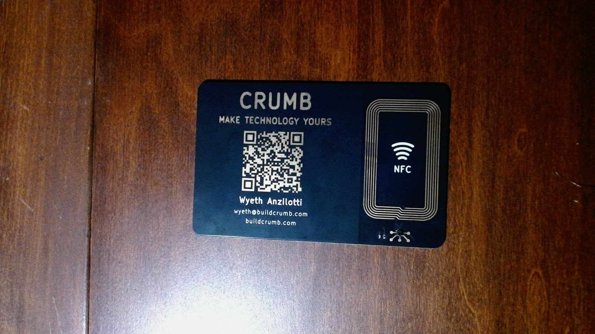
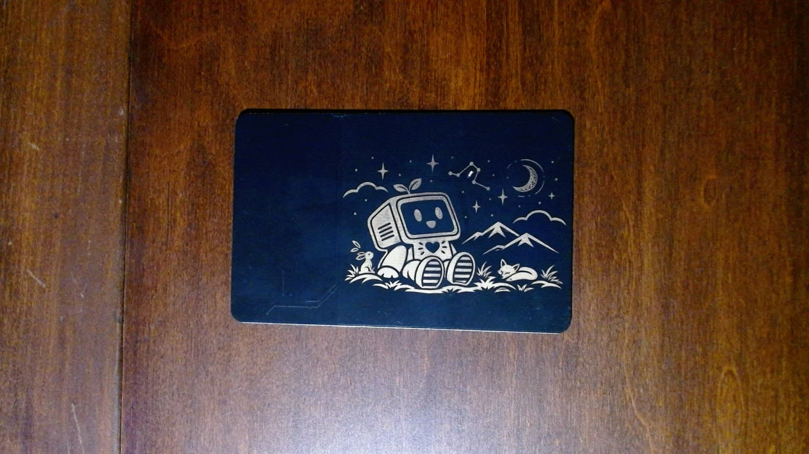

# CRUMB — PCB Business Card

**Make technology yours.**

This repository contains a guide and the design and manufacturing files to help you make your own printed circuit board (PCB) business card. It lights up and shares a website with your phone through NFC — without a battery.

| Front | Reverse |
| :---: | :---: |
|  |  |

[**Meet the maker and explore CRUMB →**](https://buildcrumb.com/card)

**Before you start:** I'll be honest — this isn't an easy project. This is my second iteration of the card. The first one worked, but not quite the way I wanted it to. All in all, I've probably spent 70–100 hours on this project.

There are a lot of finicky steps along the way, but with enough time, patience and a willingness to figure things out, you can make one yourself. Think of this guide as a journal of my experience rather than a complete, step-by-step tutorial. I've tried to document as much as I can, including the files I used and the lessons I learned, but I can't cover every little detail or edge case you might encounter.

If you get stuck or have any questions, feel free to reach out to me at [wyeth@buildcrumb.com](mailto:wyeth@buildcrumb.com). I'm happy to help.

## How the card works

The gold antenna is more than decoration. Bring a compatible NFC-enabled phone close to the card and its short-range electromagnetic field couples with the antenna. The NFC chip can use energy from that field, and the card's circuitry can illuminate its LED. The phone reads the stored web address and offers to open it. This passive design needs no battery or charging.

**Try it:** unlock your phone and bring its NFC reader close to the antenna. If the notification appears, tap it. If NFC is unavailable or disabled, scan the printed QR code with the camera instead.

This is the operating principle, not a circuit schematic. Exact chip type, antenna tuning, and LED power circuitry still need to be checked against the original design.

## From idea to finished card

I developed the concept and worked with a [PCB designer on Fiverr](https://www.fiverr.com/s/VrDaVdY) on the electrical design. He helped turn the idea into a circuit board. I handled manufacturing preparation, ordering, testing, NFC configuration, and integration with the CRUMB website.

The difficult part was getting the board assembled. I initially had neither the bill of materials (BOM) nor the pick-and-place file (CPL), and had to prepare them before placing the order. I ran into several snags along the way. Receiving a working card made the difference between designing something and actually manufacturing it clear.

You don't have to be an electrical engineer to turn an idea into a product, but this project does require some technical knowledge and patience. I collaborated with a designer, learned the manufacturing process, and tested the result. This is a case study of what I was able to build, not a guaranteed beginner tutorial.

## Make your own PCB business card

Here is the path I took, including the two steps that actually make the finished card usable: ordering it assembled and writing the NFC link.

**What did it cost?**

Around $30 was an option for bare, unassembled boards. But a bare board is not a working NFC card. Unless you have the equipment and experience to hand-solder extremely small surface-mount components, I recommend selecting PCB Assembly (PCBA) and letting the manufacturer assemble the circuit for you.

Here is what I actually spent:

- **$250 — PCB design.** I worked with [this PCB designer on Fiverr](https://www.fiverr.com/s/VrDaVdY). He helped bring my idea to life, and I recommend him based on my experience.
- **$250 — 15 assembled boards.** This included manufacturing, component assembly, shipping, taxes and tariffs.

**Total: $500 for 15 cards, or approximately $33.33 per card**, including the initial design cost. The assembled-board order alone worked out to about $16.67 per card. The design is a one-time expense if you reuse it unchanged, so future orders can cost less per card. These are my project's costs, not guaranteed manufacturing quotes.

1. **Get the design and manufacturing files.** Work with a PCB designer or adapt a reviewed design. Obtain the Gerbers and drills, BOM, and pick-and-place file before ordering.
2. **Select PCB Assembly (PCBA).** Ordering a PCB alone gets you a bare board, not a working card. I ordered the boards assembled so the NFC chip, LED and other components arrived soldered in place.
3. **Program the card with NFC Tools.** I used the app on my phone to write the website address onto the NFC chip.
4. **Test it.** Tap the card with a compatible phone, check that the website opens and the LED responds, and scan the printed QR code.

The detailed chapters below explain the general process. Start with the fundamentals if you are new to PCB design; don't place an order until your files and assembly preview have been reviewed.

## Rev 3.0 project files

| File | Purpose |
| --- | --- |
| [Gerber ZIP](CRUMB-PCB-Rev3-Gerbers.zip?raw=true) | Fabrication archive, including drill files |
| [Individual Gerber and drill files](CRUMB%20PCB%20card%20gerbers/) | Inspect the manufacturing layers |
| [BOM (XLS)](bom.xls?raw=true) | Parts list and JLCPCB part numbers |
| [JLCPCB-formatted CPL](CRUMB_Rev3_JLCPCB_CPL_Formatted.csv?raw=true) | Factory-ready placement format |
| [Original KiCad position export](PCB_Business_card_Rev_3.0-all-pos.csv?raw=true) | Original placement reference, not an additional assembly file |
| [KiCad project, board and schematic](source/) | Editable design source |

The BOM and both placement files describe the same four fitted components: C1 (220 nF), R3 (220 Ω), D1 (0402 LED), and U1 (NT3H1101W0FHKH). Use the formatted CPL for the JLCPCB upload, not both placement files. **Assembly is on both sides:** D1 is on the bottom; C1, R3 and U1 are on the top.

The Gerber ZIP contains 12 files, including the two drill files. The individual files match the archive's recorded CRC checksums. The Gerber job metadata describes a two-layer, 1.6 mm board, approximately 86.65 × 54.81 mm; this does not establish the exact successful factory order settings. The actual finish, part availability, assembly selection and pricing must be confirmed before ordering.

The recovered KiCad source has not yet been independently checked by regenerating all manufacturing outputs. It references custom symbol/footprint libraries that are not included as separate library files; check the embedded design and missing-library warnings before editing or regenerating outputs. This is a project case study and general workflow, not a guarantee that a new order will work unchanged.

### Customize an existing design

If you have permission to use an existing, complete design, make a separate copy of its KiCad project. Confirm the license, inspect the actual copper, mask and silkscreen layers, and identify the artwork and QR-code elements. Replace only the intended text and decorative geometry, then validate the new QR destination. Preserve the NFC antenna, routing, pads, component layout and electrical clearances unless a qualified designer reviews the changes. Artwork changes on conductive layers can affect antenna performance.

### Design your own from scratch

Learn PCB design using [KiCad's PCB Editor documentation](https://docs.kicad.org/9.0/en/pcbnew/pcbnew.html), or [work with the designer who helped me](https://www.fiverr.com/s/VrDaVdY). Specify the intended phone interaction, LED behavior, card dimensions, finish and target manufacturer. Request editable schematic and board source, all required custom footprints and artwork, manufacturing outputs, assembly drawing, BOM, pick-and-place data, and design rules. Agree on ownership and redistribution rights in writing.

### 01. Understand the PCB and NFC

A printed circuit board (PCB) holds components and electrically connects them using conductive traces. A passive NFC tag exchanges a small amount of data with a nearby reader and gets operating energy from the reader's field. Start with a known working NFC design; antenna geometry, tuning, component ratings and energy harvesting need engineering review. Decide what your card should communicate and whether it needs a light.

### 02. Obtain and edit the design files

Open the editable KiCad project, not just exported Gerbers. Inspect the schematic and board layout together, check for missing libraries, and confirm the intended manufacturing revision. Identify decorative layers before editing. Check the QR code on a printed proof and update all personal text, URLs and artwork consistently. Run electrical and board design-rule checks and review any warnings with the designer.

### 03. Prepare Gerbers and drill files

Gerbers describe the geometry of the physical board layers: copper, solder mask, silkscreen and outline as applicable. Drill files describe holes. Export the required layers and drills from the PCB editor using your manufacturer's accepted format. Inspect every output in a Gerber viewer for board outline, antenna, text, mask openings, and alignment. Do not assume an export preset matches your factory's requirements.

### 04. Understand the bill of materials (BOM)

The BOM is the parts list: reference designators, quantities, manufacturer part numbers, packages and values. Match it to the exact schematic and board revision. Confirm the assembly service has each part in stock, including the NFC chip and LED. Do not accept a substitution simply because its package looks similar; electrical characteristics and compatibility matter.

### 05. Understand the pick-and-place file

The component placement list (CPL or pick-and-place file) tells the assembly machine where each fitted component belongs, on which side, and with what rotation. Match its reference designators to the BOM and layout. Confirm units, origin, sides, and rotations against the factory's requirements and assembly preview. Pay particular attention to polarized LEDs, IC pin 1, and any parts that should not be placed.

### 06. Order fabricated and assembled boards

**Select PCB Assembly (PCBA)** if you want the manufacturer to install the parts. PCB fabrication alone creates the bare board. PCBA adds the component placement and soldering needed to make the circuit functional.

The bare-board option was around $30, but it would have required hand-soldering extremely small components. I chose PCBA and paid approximately $250 for 15 assembled boards, including shipping, taxes and tariffs. That is about $16.67 per assembled board before the separate $250 design cost. Actual quotes depend on the design, quantity, components and shipping.

Upload the Gerbers and drill files for fabrication, then the BOM and pick-and-place file for assembly. Confirm the component selections, orientation, board finish and dimensions against the reviewed design. Select assembly on both sides for this design; the LED is on the bottom. Use the formatted JLCPCB CPL linked above. Check both previews and the full quote before paying. This is the general ordering workflow, not a verified list of my exact factory settings.

### 07. Inspect and test the delivered boards

Check the board finish, outline, artwork, antenna and component population against the design. Inspect joints and orientations for visible defects; do not apply an external supply to a passive design unless the schematic specifies it. Test NFC reading with a compatible phone, confirm the intended LED response, and test the QR code. Record which boards pass and the conditions used for testing.

### 08. Program an NFC website link

I used **NFC Tools** on my phone to program the website link onto the assembled card. On a compatible phone and writable NFC tag:

1. Install NFC Tools by wakdev and open the Write tab.
2. Choose Add a record, select URL / URI, and enter your full website address. I used `https://buildcrumb.com/card/`.
3. Confirm the record, select Write, and hold the card near the phone's NFC reader until the app confirms success.
4. Read the card again, test the website link, and check the LED and printed QR code.

See the [official NFC Tools URL-writing instructions](https://www.wakdev.com/en/knowledge-base/how-to-guides/how-to-write-a-link-url-on-an-nfc-chip.html) for the app screens. Some tags are read-only or incompatible. Do not permanently lock the tag until you have verified the correct destination and understand that locking may be irreversible.

### 09. Troubleshoot common problems

If no NFC notification appears, check phone compatibility, NFC settings, reader position, metal interference, and whether the tag can be read with a compatible app. If the URL is wrong, read back the stored record and reprogram only if writable. If the LED does not light, compare orientation, component population and antenna/circuit design with the verified assembly; ask the designer to diagnose it. If an order preview shows missing or rotated parts, reconcile the BOM and placement files before approval.

## Further reading

- [KiCad PCB Editor documentation](https://docs.kicad.org/9.0/en/pcbnew/pcbnew.html) — exporting fabrication outputs, drills and placement files.
- [PCB assembly file requirements and ordering example](https://jlcpcb.com/help/article/pcb-assembly-faqs) — a manufacturer's explanation of fabrication files, BOM and placement data.
- [Component matching and file preparation](https://jlcpcb.com/help/article/advice-for-bom-and-cpl-files-preparation) — one manufacturer's format and designator requirements.
- [NFC tags and passive power](https://developer.att.com/technical-library/device-technologies/nfc-tags) — an introduction to NFC data and energy transfer.

## About CRUMB and reuse rights

CRUMB is a free educational workshop for people who want to understand, build and customize technology. This repository is the home of the full manufacturing guide and project files. The [card showcase](https://buildcrumb.com/card/) introduces the project and provides contact information and links to the wider workshop.

The electrical hardware design and manufacturing files (KiCad source, Gerbers, drill files, BOM and placement files) are licensed under the [CERN Open Hardware Licence v2 — Permissive (CERN-OHL-P-2.0)](LICENSE), to the extent CRUMB holds the necessary rights. You may study, modify, manufacture, share and sell your own versions under the licence terms, including retaining applicable notices and documenting modifications when distributing modified source.

CRUMB branding, original artwork, photographs and personal contact information are not included in this hardware licence. Replace these elements with your own before distributing your customized cards. Third-party materials remain subject to their applicable rights. The design is provided as-is, without warranty; verify your manufacturing files before ordering.

Earlier versions distributed under the MIT License retain any rights validly granted under that licence.

**[Explore CRUMB](https://buildcrumb.com/build/) · [Card showcase](https://buildcrumb.com/card/) · [Contact](mailto:wyeth@buildcrumb.com)**
